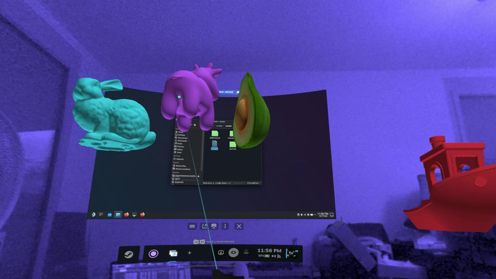
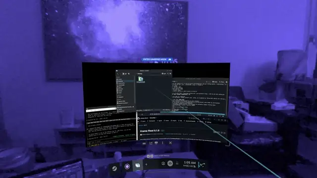
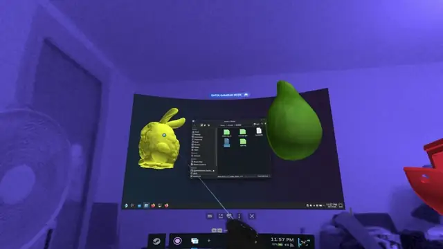

# Frame Float

A tiny mixed-reality toy for the **Steam Frame** (SteamOS, ARM64). A cube, or any 3D model you load (STL, OBJ, PLY, glTF), floats in front of you over passthrough and SteamVR's desktop mode. Only the object is drawn; everything around it stays see-through, and your desktop stays usable.



It's also a working example of a SteamVR **overlay** that:

- renders a correct **3D object** on a flat overlay, using head-tracked, per-eye off-axis ("window") projection,
- runs **alongside desktop mode** without replacing it,
- gets **controller input while the SteamVR dashboard owns the controllers**, through laser mouse and scroll events.

## Loading a model

```sh
./frame-float-overlay                       # the cube
./frame-float-overlay models/3DBenchy.stl   # any .stl .obj .ply .gltf .glb
```

Supported formats:

| Format | What's read |
|---|---|
| **STL** | Binary and ASCII. Converted from Z-up (the usual 3D-printing convention) to Y-up. |
| **OBJ** | Positions, UVs, normals, polygons (triangulated), and optional `v x y z r g b` vertex colors. Smooth normals are computed when the file has none. |
| **PLY** | ASCII and binary (little and big endian): positions, optional normals and vertex colors, faces. |
| **glTF 2.0** | `.gltf` (external or embedded buffers) and `.glb`. Node transforms, normals, vertex colors, base color factor and base color texture. |

Whatever its original size, the model is centered and scaled to the same size as the cube. Models that bring their own colors (textures, vertex or material colors) start in their original look; clicking cycles through color tints.

**Bonus:** a phone circuit board (`.glb`, 48,868 triangles) opened, grabbed and turned, in its own colors:



To get one free sample of each format, run:

```sh
models/fetch.sh
```

| File | Source | License |
|---|---|---|
| `3DBenchy.stl` | [3DBenchy](https://www.3dbenchy.com) by Creative Tools | CC BY-ND 4.0 |
| `spot.obj` | [Spot](https://www.cs.cmu.edu/~kmcrane/Projects/ModelRepository/) by Keenan Crane | CC0 |
| `bunny.ply` | [Stanford Bunny](https://graphics.stanford.edu/data/3Dscanrep/), Stanford Computer Graphics Laboratory | free use with credit |
| `Avocado.glb` | [Avocado](https://github.com/KhronosGroup/glTF-Sample-Assets/tree/main/Models/Avocado), Khronos glTF Sample Assets | CC0 |

The models are downloaded, not stored in this repo.

## Controls

Point the controller's laser at the object. In desktop mode, SteamVR turns every button into a laser click, so R1 and R2 do the same thing:

| Input | Action |
|---|---|
| Click **R1** or **R2** | Change color (8-color cycle) |
| Hold **R1** or **R2** (≥ 0.3 s) | Grab: the object glides onto your laser and follows your hand |
| **Stick** up / down | Push the object away / pull it closer along the laser |
| **Stick** left / right while grabbing | Past about half-way, takes over from the auto-spin and turns the object (it stays level) |
| Let go of **R1** / **R2** | Drop it; the auto-spin resumes |
| While grabbing, pull it all the way in and keep holding the **stick** down | When the object touches your controller, a ring around it fills (about 1.5 s); when the ring is full, the object closes. Let go of the stick and the ring drains. |

Outside desktop mode, the SteamVR Input bindings in `bindings_frame_controller.json` apply, on either controller: **L1 / R1** change color, **L2 / R2** grab, and the **sticks** push and pull.



When an object first appears, it's 80 cm in front of where you're looking, slightly below eye level. It always faces the same way in the room, so you can walk around it.

## Building

On the Steam Frame itself (SteamOS has the toolchain and headers):

```sh
make            # builds both programs
./frame-float-overlay
```

Requirements:

- SteamVR installed at `/opt/steamvr` (the Steam Frame default). The Makefile links against `libopenvr_api.so` and `libopenxr_loader.so` from `/opt/steamvr/bin/linuxarm64`.
- Mesa EGL and OpenGL 3.3, plus the OpenXR headers (for the optional `frame-float` scene app).
- A C/C++ compiler and `make`.

`actions.json` and the `bindings_*.json` files must sit next to the binary.

## Installing as an Arch package

There are two packages. Both install the overlay as `frame-float` with a desktop launcher, so you can open models from your file manager.

| Package | Builds |
|---|---|
| `packaging/arch/frame-float/` | The latest release (`v0.1.0`). A prebuilt copy is attached to the [release](https://github.com/philippe-alfaiate/frame-float/releases/latest). |
| `packaging/arch/frame-float-git/` | The newest code on `main`. |

```sh
cd packaging/arch/frame-float     # or frame-float-git
makepkg -f
sudo steamos-readonly disable      # SteamOS only: the system is read-only
sudo pacman -U frame-float-*.pkg.tar.zst
sudo steamos-readonly enable
frame-float model.stl              # or launch "Frame Float" from the menu
```

What the package installs:

| Path | What |
|---|---|
| `/usr/bin/frame-float` | Link to the overlay |
| `/usr/lib/frame-float/` | The overlay, `actions.json` and the bindings |
| `/usr/share/applications/frame-float.desktop` | Launcher, opens STL, OBJ, PLY and glTF files |
| `/usr/share/licenses/frame-float/` | MIT license and the bundled third-party licenses |

SteamVR isn't a pacman package, so it isn't listed as a dependency; it must already be in `/opt/steamvr`. On SteamOS, a system update replaces the read-only system and removes the package, so install it again afterwards. To uninstall: `sudo pacman -R frame-float` (or `frame-float-git`).

To install from a local checkout without the package, `make install` takes the usual `PREFIX` and `DESTDIR`.

## Files

| File | What it is |
|---|---|
| `overlay.cpp` | **The main program**: the SteamVR overlay version described above. |
| `model.cpp`, `model.h` | Model loaders (STL, OBJ, PLY, glTF/GLB) that produce one GPU-ready triangle list. |
| `models/fetch.sh` | Downloads the sample models. |
| `main.c` | An earlier version as a full OpenXR scene app. It takes over the headset, so no passthrough and no desktop. It's kept as a minimal OpenXR + EGL example. |
| `packaging/arch/` | Arch package builds, release and `-git` (see [Installing as an Arch package](#installing-as-an-arch-package)). |
| `frame-float.desktop` | Desktop launcher installed by `make install`. |
| `actions.json`, `bindings_*.json` | SteamVR Input manifest. It's only used outside desktop mode (L1/R1 color, L2/R2 grab, stick push/pull). |
| `third_party/openvr/` | `openvr.h` from [ValveSoftware/openvr](https://github.com/ValveSoftware/openvr) v2.15.6, BSD-3-Clause. |
| `third_party/cgltf/` | [cgltf](https://github.com/jkuhlmann/cgltf) v1.15 glTF parser, MIT. |
| `third_party/stb/` | [stb_image](https://github.com/nothings/stb) v2.30 for glTF textures (PNG and JPEG), public domain. |

## How it works

### Overlay instead of scene app

An OpenXR or OpenVR *scene* app replaces whatever the headset is showing, including desktop mode and passthrough. A SteamVR overlay (`VRApplication_Overlay`) is composited on top instead. The overlay texture is transparent except for the cube.

### 3D on a flat overlay

The overlay uses `VROverlayFlags_SideBySide_Parallel`, so the left half of the texture goes to the left eye and the right half to the right eye. Each frame, the app:

1. predicts the headset pose for when the frame will reach the display,
2. turns the overlay (yaw only) to face you,
3. converts each eye's position (`GetEyeToHeadTransform`) into overlay space,
4. renders the cube through the overlay rectangle with an off-axis frustum from that exact eye position.

The overlay behaves like a window into a small 3D space, so parallax stays right as you move. Rendering is synced with `WaitFrameSync` and submitted as double-buffered OpenGL textures. `SetOverlayRaw` uploads flicker, so they're only a fallback.

### Input under desktop mode

Steam Frame desktop mode is the SteamVR dashboard. While it's visible, SteamVR turns off normal controller input for every app (`IsInputAvailable() == false`), and that includes SteamVR Input actions, even with the experimental global action set priority. What an overlay does receive:

| What you do | What the overlay receives |
|---|---|
| Any click (R1, R2) | `VREvent_MouseButtonDown` / `Up` (always button 1) |
| Stick | `VREvent_ScrollSmooth` with `VROverlayFlags_SendVRSmoothScrollEvents` (≈ ±0.22 per event at full deflection) |

Discrete scroll events are left off on purpose: their "notches" make SteamVR vibrate the controller on every tick.

A few details that keep this reliable:

- **Hold detection** uses each event's `eventAgeSeconds`, not frame counts. When desktop mode is busy (its keyboard is open, for example), the press and release can arrive together.
- **Keyboard:** desktop mode moves its on-screen keyboard to whatever overlay the laser focuses. The app closes any keyboard opened for the cube (`HideKeyboard`); yours comes back when you return to your window.
- **Click hit test:** clicks only count on the object, not the transparent area around it. The app reads back the alpha under the laser in both eye images.

## Debugging

Environment variables:

| Variable | Effect |
|---|---|
| `FRAMEFLOAT_DEBUG=1` | Log input, focus and keyboard events to stdout |
| `FRAMEFLOAT_DUMP=frame.pam` | Save the first rendered frame (RGBA, PAM format) |
| `FRAMEFLOAT_RAW=1` | Use `SetOverlayRaw` uploads instead of GL textures |

SteamVR's own logs are in `~/.local/share/Steam/logs/` (`vrserver.txt`, `vrclient_frame-float-overlay.txt`).

## Known limitations

- **Laser only:** in desktop mode, every button arrives as the same laser click, so R1 and R2 can't do different things.
- **Viewing angle:** the 3D effect is a window: from far off to the side or behind, the panel's edges clip the cube.
- **Platform:** it has only been tested on a Steam Frame (SteamVR 2.18, Adreno 750, Mesa Zink).

## Roadmap

The goal is to go beyond the cube: **load any 3D object** and place it in your space the same way, over passthrough and desktop mode.

- [x] Load models from files: STL, OBJ, PLY and glTF/GLB.
- [x] Scale the model automatically so it fits in front of you.
- [x] Shading that suits imported meshes, with their colors and textures.
- [x] Open a model from the command line, or with "Open With" in the file manager.
- [ ] Pick a file from inside VR (file picker).
- [ ] Resize the model with the controls.
- [ ] More formats (FBX, 3MF) and glTF extras (normal maps, PBR lighting, animation).

## License

MIT, see [LICENSE](LICENSE). Bundled third-party code keeps its own license: OpenVR header (BSD-3-Clause, Valve), cgltf (MIT, Johannes Kuhlmann) and stb_image (public domain or MIT, Sean Barrett). Each license is in its `third_party/` folder. The sample models are not included; see their licenses above.
